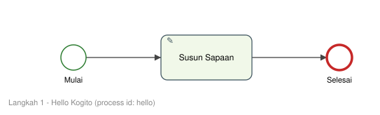
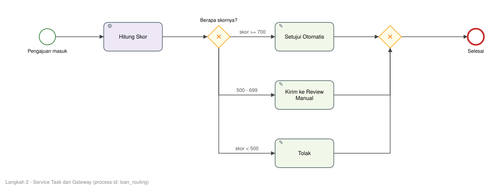
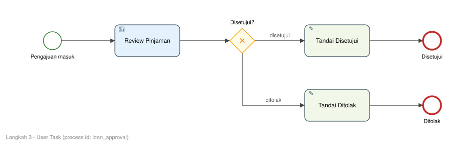
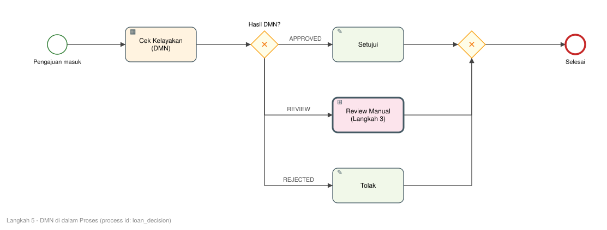
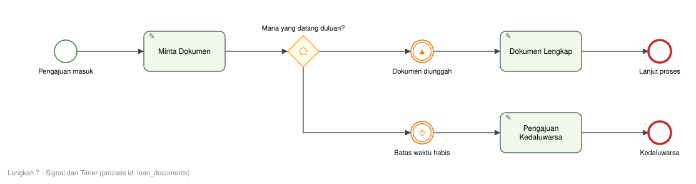
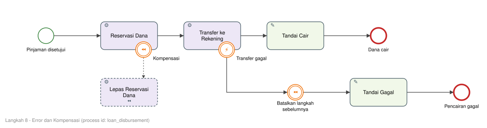

# Kogito Walkthrough

Modul ini adalah tempat belajar dan coba-coba Kogito, disusun sebagai tur bertahap. Setiap langkah memperkenalkan satu kemampuan Kogito, punya file model sendiri (BPMN, DMN, atau DRL), contoh `curl` yang bisa langsung dicoba, dan test otomatis yang membuktikan perilakunya.

Semua langkah memakai satu cerita yang sama: **pengajuan pinjaman**. Datanya selalu berbentuk `Applicant`:

```json
{ "name": "Budi", "age": 30, "monthlyIncome": 10000000, "requestedAmount": 30000000, "creditScore": 750 }
```

Stack: Java 17, Quarkus 3.15.3, Kogito / jBPM / Drools 10.1.0. Tidak butuh database, Kafka, atau Podman.

## Peta langkah

| # | Langkah | Kemampuan Kogito | File model | Endpoint utama | Test |
|---|---|---|---|---|---|
| 1 | [Hello Kogito](#langkah-1-hello-kogito) | Proses BPMN pertama, Script Task, REST yang di-generate | `step01-hello.bpmn` | `POST /hello` | `Step01HelloTest` |
| 2 | [Service Task dan Gateway](#langkah-2-service-task-dan-gateway) | Memanggil CDI bean Java, percabangan XOR | `step02-routing.bpmn` | `POST /loan_routing` | `Step02RoutingTest` |
| 3 | [User Task](#langkah-3-user-task) | Wait state, task untuk manusia, grup, lifecycle claim/complete | `step03-approval.bpmn` | `POST /loan_approval`, `/usertasks/instance` | `Step03UserTaskTest` |
| 4 | [DMN](#langkah-4-dmn) | Decision table, FEEL, keputusan sebagai REST service | `LoanEligibility.dmn` | `POST /LoanEligibility` | `Step04DmnTest` |
| 5 | [DMN di dalam proses](#langkah-5-dmn-di-dalam-proses) | Business Rule Task, Call Activity (subproses) | `step05-decision-in-process.bpmn` | `POST /loan_decision` | `Step05DecisionInProcessTest` |
| 6 | [Rule DRL](#langkah-6-rule-drl) | Rule Unit, OOPath, forward chaining, query sebagai REST | `LoanRules.drl` + `LoanRules.java` | `POST /find-alerts` | `Step06RulesTest` |
| 7 | [Signal dan Timer](#langkah-7-signal-dan-timer) | Event-Based Gateway, signal dari luar, timer | `step07-events.bpmn` | `POST /loan_documents/{id}/documentsUploaded` | `Step07EventsTest` |
| 8 | [Error dan Kompensasi](#langkah-8-error-dan-kompensasi) | Boundary Error Event, compensation handler | `step08-compensation.bpmn` | `POST /loan_disbursement` | `Step08CompensationTest` |

Semua file model ada di [`src/main/resources/com/example/walkthrough/`](src/main/resources/com/example/walkthrough/). File BPMN sudah berisi diagram (DI), jadi bisa dibuka di editor visual seperti ekstensi VS Code **"Apache KIE Business Modeler"** atau [sandbox.kie.org](https://sandbox.kie.org).

## Menjalankan

```bash
cd kogito-walkthrough

mvn test          # 25 test, satu kelas per langkah
mvn quarkus:dev   # http://localhost:8082
```

Saat `quarkus:dev` berjalan:

- **Swagger UI**: http://localhost:8082/q/swagger-ui. Semua endpoint yang di-generate Kogito ada di sini, jadi ini cara tercepat untuk melihat "apa saja yang otomatis dibuatkan".
- **Live reload**: ubah file `.bpmn`, `.dmn`, atau `.drl`, lalu panggil endpoint lagi. Quarkus men-generate ulang kodenya tanpa restart manual.
- **Tur otomatis**: [`walkthrough.sh`](walkthrough.sh) menjalankan semua contoh `curl` di bawah secara berurutan, berhenti di tiap langkah sampai Enter ditekan.

```bash
./walkthrough.sh               # butuh curl dan jq
```

## Cara Kogito bekerja (singkat)

Kogito adalah engine **build-time**. Saat `mvn compile` / `quarkus:dev`, Kogito membaca semua `.bpmn`, `.dmn`, dan `.drl` lalu men-generate kode Java biasa: class model, engine proses, dan REST resource. Hasilnya bisa diintip di `target/generated-sources/kogito/`. Contohnya, `step01-hello.bpmn` menghasilkan `HelloResource.java` dengan endpoint `POST /hello`, `GET /hello`, `GET /hello/{id}`, dan `DELETE /hello/{id}`.

Akibatnya:

- Kesalahan di model (variabel salah tulis, tipe tidak cocok, ekspresi FEEL invalid) ketahuan saat build, bukan saat runtime.
- Tidak ada "deploy proses" ke server terpisah. Proses adalah bagian dari aplikasi Quarkus.
- Process instance disimpan in-memory secara default. Instance yang sudah selesai langsung dihapus, jadi `GET /hello/{id}` setelah proses selesai akan `404`. Karena itu modul ini punya [`ProcessJournal`](src/main/java/com/example/walkthrough/journal/ProcessJournal.java), sebuah *process event listener* yang mencatat node yang dilewati dan variabel akhir setiap proses. Lihat hasilnya di `GET /journal/{processInstanceId}`.

---

## Langkah 1: Hello Kogito



**Konsep.** Proses BPMN paling kecil: Start Event → Script Task → End Event. Process variable `name` menjadi input dan `greeting` menjadi output. Script Task menjalankan potongan Java dan mengakses variabel lewat `kcontext`:

```java
String who = (name == null || name.isBlank()) ? "Dunia" : name;
kcontext.setVariable("greeting", "Halo, " + who + "! Selamat datang di Kogito.");
```

**Coba.**

```bash
curl -s -X POST localhost:8082/hello -H 'Content-Type: application/json' -d '{"name":"Hilmi"}'
# {"id":"<uuid>","name":"Hilmi","greeting":"Halo, Hilmi! Selamat datang di Kogito."}

curl -s localhost:8082/journal/<uuid>
# {"processId":"hello","nodes":["Mulai","Susun Sapaan","Selesai"],"completed":true,...}
```

**Yang perlu diperhatikan.** Nama endpoint diambil dari atribut `id` proses (`hello`), bukan nama file. Respons berisi semua process variable, karena proses ini tidak menandai variabel mana yang internal.

**Latihan.** Tambahkan process variable `language` dan buat sapaan dalam bahasa Inggris kalau nilainya `"en"`. Jalankan `quarkus:dev` dan lihat field baru langsung muncul di Swagger UI.

## Langkah 2: Service Task dan Gateway



**Konsep.** Service Task memanggil method di CDI bean biasa. Hubungannya ditulis di BPMN:

```xml
<bpmn2:serviceTask id="Task_Score" name="Hitung Skor" implementation="Java"
    drools:serviceinterface="com.example.walkthrough.service.ScoringService"
    drools:serviceoperation="score">
```

Parameter method diisi dari process variable `applicant`, dan nilai kembaliannya disimpan ke variable `score`. Exclusive Gateway (XOR) lalu memilih **tepat satu** cabang dari kondisi Java di tiap sequence flow (`return score >= 700;`). Gateway kedua menggabungkan cabang kembali.

[`ScoringService`](src/main/java/com/example/walkthrough/service/ScoringService.java) mengambil credit score, lalu mengurangi 100 kalau cicilan 12 bulan lebih dari 30% penghasilan.

| Skor | Cabang | `route` |
|---|---|---|
| ≥ 700 | Setujui Otomatis | `AUTO_APPROVED` |
| 500–699 | Kirim ke Review Manual | `MANUAL_REVIEW` |
| < 500 | Tolak | `REJECTED` |

**Coba.**

```bash
curl -s -X POST localhost:8082/loan_routing -H 'Content-Type: application/json' -d '{
  "applicant": {"name":"Budi","age":30,"monthlyIncome":10000000,"requestedAmount":200000000,"creditScore":750}
}'
# score 650 (kena penalti cicilan), route MANUAL_REVIEW
```

**Latihan.** Hapus kondisi di salah satu sequence flow dan jalankan `mvn compile`. Atau buat dua kondisi yang sama-sama `true` dan lihat bahwa XOR tetap hanya mengambil satu cabang.

## Langkah 3: User Task



**Konsep.** User Task adalah *wait state*: proses berhenti dan disimpan sampai ada orang yang menyelesaikan task-nya. Task ini diberi nama `ReviewLoan` dan ditujukan ke grup `credit-officers` lewat input `GroupId`. Data `applicant` dikirim ke task sebagai input, sementara `approved` dan `note` adalah output yang diisi petugas.

Kogito 10 punya API user task tersendiri di `/usertasks/instance`. Identitas pengguna disimulasikan lewat query parameter `user` dan `group` (di produksi diambil dari token login).

**Coba.**

```bash
# 1. Mulai proses. Prosesnya tetap aktif.
curl -s -X POST localhost:8082/loan_approval -H 'Content-Type: application/json' -d '{
  "applicant": {"name":"Citra","age":28,"monthlyIncome":8000000,"requestedAmount":40000000,"creditScore":680}
}'
curl -s localhost:8082/loan_approval            # daftar instance yang masih menunggu

# 2. Lihat task sebagai anggota credit-officers. Ambil "id" task-nya.
curl -s 'localhost:8082/usertasks/instance?user=ani&group=credit-officers'

# 3. Klaim, lalu selesaikan dengan output.
curl -s -X POST 'localhost:8082/usertasks/instance/<taskId>/transition?user=ani&group=credit-officers' \
  -H 'Content-Type: application/json' -d '{"transitionId":"claim"}'
curl -s -X POST 'localhost:8082/usertasks/instance/<taskId>/transition?user=ani&group=credit-officers' \
  -H 'Content-Type: application/json' -d '{"transitionId":"complete","data":{"approved":true,"note":"Dokumen lengkap"}}'

# 4. Proses selesai.
curl -s localhost:8082/journal/<processInstanceId>
```

**Yang perlu diperhatikan.** Pengguna di luar grup (`?user=joko&group=marketing`) tidak melihat task ini. `GET /usertasks/instance/<taskId>/transition` menampilkan transisi yang boleh dilakukan dari status task saat ini (misalnya `claim`, `release`, `skip`, `complete`).

**Latihan.** Coba `complete` tanpa `claim` lebih dulu, atau `claim` sebagai user lain setelah `ani` mengklaim. Tambahkan komentar lewat `POST /usertasks/instance/<taskId>/comments`.

## Langkah 4: DMN

**Konsep.** DMN (Decision Model and Notation) memisahkan *keputusan bisnis* dari alur proses. [`LoanEligibility.dmn`](src/main/resources/com/example/walkthrough/LoanEligibility.dmn) punya dua input dan tiga decision yang saling bergantung:

```
Applicant ──────────┬──► Risk Category ──┬──► Max Loan ──┐
                    │                    │               ├──► Eligibility
Requested Amount ───┴────────────────────┴───────────────┘
```

**Risk Category**: decision table, hit policy `UNIQUE` (tepat satu baris boleh cocok).

| `Applicant.creditScore` | Risk Category |
|---|---|
| `>= 700` | `"LOW"` |
| `[600..700)` | `"MEDIUM"` |
| `< 600` | `"HIGH"` |

**Max Loan**: literal expression FEEL.

```
Applicant.monthlyIncome * (if Risk Category = "LOW" then 12 else if Risk Category = "MEDIUM" then 6 else 0)
```

**Eligibility**: decision table, hit policy `FIRST` (baris pertama yang cocok menang, jadi urutan penting).

| `Applicant.age` | `Risk Category` | `Requested Amount <= Max Loan` | Eligibility |
|---|---|---|---|
| `< 21` | - | - | `"REJECTED"` |
| - | `"HIGH"` | - | `"REJECTED"` |
| - | - | `true` | `"APPROVED"` |
| - | - | - | `"REVIEW"` |

Kogito men-generate endpoint dari **nama model** DMN. Body request berisi semua Input Data, dan respons berisi input ditambah hasil semua decision.

**Coba.**

```bash
curl -s -X POST localhost:8082/LoanEligibility -H 'Content-Type: application/json' -d '{
  "Applicant": {"name":"Dewi","age":30,"monthlyIncome":10000000,"creditScore":650},
  "Requested Amount": 50000000
}'
# "Risk Category":"MEDIUM", "Max Loan":60000000, "Eligibility":"APPROVED"

# Versi lengkap dengan pesan validasi dan status tiap decision:
curl -s -X POST localhost:8082/LoanEligibility/dmnresult -H 'Content-Type: application/json' -d '{...}'
```

**Latihan.** Buka file DMN di editor visual. Ubah hit policy `Eligibility` menjadi `UNIQUE` lalu panggil endpoint-nya. Baris terakhir (`-`, `-`, `-`) tumpang tindih dengan semua baris lain, jadi lihat bagaimana Kogito melaporkannya (saat build atau di `/dmnresult`). Kirim `creditScore` berupa string dan bandingkan respons `/LoanEligibility` dengan `/LoanEligibility/dmnresult`.

## Langkah 5: DMN di dalam proses



**Konsep.** Dua cara menggabungkan model:

1. **Business Rule Task** (`implementation="http://www.jboss.org/drools/dmn"`) memanggil DMN Langkah 4. Input `namespace` dan `model` menunjuk ke file DMN-nya. Input lain dipetakan ke Input Data DMN berdasarkan nama (`Applicant`, `Requested Amount`), dan nama output adalah nama decision (`Eligibility`, `Risk Category`, `Max Loan`). `Requested Amount` diisi dengan ekspresi `#{applicant.requestedAmount}`.
2. **Call Activity** menjalankan proses lain sebagai subproses. Kalau DMN menjawab `REVIEW`, proses `loan_approval` dari Langkah 3 dijalankan sebagai *child process instance*, dan output `status`-nya dibawa kembali ke proses induk.

**Coba.**

```bash
curl -s -X POST localhost:8082/loan_decision -H 'Content-Type: application/json' -d '{
  "applicant": {"name":"Hana","age":30,"monthlyIncome":10000000,"requestedAmount":80000000,"creditScore":650}
}'
# eligibility REVIEW, proses induk menunggu

curl -s localhost:8082/loan_approval    # instance anak muncul di sini
# lalu selesaikan user task-nya seperti di Langkah 3; proses induk ikut selesai
```

**Latihan.** Ganti `drools:waitForCompletion="true"` di Call Activity menjadi `false` dan lihat bedanya: proses induk tidak menunggu anaknya.

## Langkah 6: Rule DRL

**Konsep.** DRL (Drools Rule Language) cocok untuk aturan yang banyak dan saling memicu, yang sulit ditulis sebagai tabel. Kogito memakai **Rule Unit**:

- [`LoanRules.java`](src/main/java/com/example/walkthrough/LoanRules.java) mendeklarasikan sumber data: `DataStore<Applicant> applicants` dan `DataStore<Alert> alerts`.
- [`LoanRules.drl`](src/main/resources/com/example/walkthrough/LoanRules.drl) berisi rule `when ... then ...` yang mencocokkan fakta lewat OOPath (`/applicants[ creditScore < 600 ]`).
- Setiap `query` menjadi endpoint REST: `FindAlerts` → `POST /find-alerts`, `FindCriticalAlerts` → `POST /find-critical-alerts`.

| Rule | Kondisi | Hasil |
|---|---|---|
| Skor kredit rendah | `creditScore < 600` | Alert `HIGH` |
| Pemohon di bawah 21 tahun | `age < 21` | Alert `HIGH` |
| Cicilan terlalu berat | pinjaman > 3,6 × penghasilan | Alert `MEDIUM` |
| Banyak peringatan | pemohon punya ≥ 2 alert non-CRITICAL | Alert `CRITICAL` |

Rule terakhir menunjukkan **forward chaining**: rule ini bereaksi pada Alert yang *dibuat oleh rule lain*. Engine menjalankan ulang pencocokan setiap ada fakta baru, sampai tidak ada rule yang bisa terpicu lagi.

**Coba.**

```bash
curl -s -X POST localhost:8082/find-alerts -H 'Content-Type: application/json' -d '{
  "applicants": [
    {"name":"Mira","age":19,"monthlyIncome":5000000,"requestedAmount":50000000,"creditScore":500},
    {"name":"Nanda","age":30,"monthlyIncome":10000000,"requestedAmount":20000000,"creditScore":720}
  ]
}'
# 4 alert untuk Mira (3 biasa + 1 CRITICAL), tidak ada untuk Nanda

curl -s -X POST localhost:8082/find-critical-alerts -H 'Content-Type: application/json' -d '{ ...sama... }'
```

**Latihan.** Tambahkan rule baru, misalnya alert `LOW` untuk penghasilan di bawah UMR, lalu lihat apakah rule "Banyak peringatan" ikut terpicu untuk pemohon yang sebelumnya aman.

## Langkah 7: Signal dan Timer



**Konsep.** Setelah meminta dokumen, proses menunggu di **Event-Based Gateway**. Cabang yang dipilih ditentukan oleh event mana yang **datang duluan**:

- **Signal** `documentsUploaded` dikirim dari luar lewat endpoint yang di-generate: `POST /loan_documents/{id}/documentsUploaded`. Body-nya disimpan ke variable `documents`.
- **Timer** dengan durasi ISO-8601 dari variable `timeout` (`#{timeout}`, default `PT24H`). Timer dijalankan oleh job service in-memory bawaan Kogito.

**Coba.**

```bash
# Kirim signal sebelum timer habis
curl -s -X POST localhost:8082/loan_documents -H 'Content-Type: application/json' -d '{
  "applicant": {"name":"Oki","age":30,"monthlyIncome":10000000,"requestedAmount":20000000,"creditScore":720},
  "timeout": "PT1H"
}'
curl -s -X POST localhost:8082/loan_documents/<id>/documentsUploaded -H 'Content-Type: application/json' -d 'KTP, NPWP, slip gaji'
# status DOCUMENTS_RECEIVED

# Biarkan timer menang
curl -s -X POST localhost:8082/loan_documents -H 'Content-Type: application/json' -d '{"applicant":{"name":"Oki"},"timeout":"PT5S"}'
# tunggu 5 detik, lalu: curl -s localhost:8082/journal/<id>  -> status EXPIRED
```

**Yang perlu diperhatikan.** Karena tipe data signal adalah `String`, body dibaca apa adanya, tanpa tanda kutip JSON. Timer in-memory hilang kalau aplikasi di-restart; di produksi Kogito memakai Jobs Service terpisah dan persistence.

**Latihan.** Ganti Event-Based Gateway dengan **Boundary Timer Event** di sebuah User Task (misalnya task Langkah 3), supaya task otomatis eskalasi kalau tidak dikerjakan dalam waktu tertentu.

## Langkah 8: Error dan Kompensasi



**Konsep.** Pencairan dana terdiri dari dua langkah: reservasi dana lalu transfer. Kalau transfer gagal, reservasi harus dibatalkan.

- **Boundary Error Event** di task "Transfer ke Rekening" menangkap `TransferFailedException` (`errorCode` di BPMN adalah nama class exception-nya). [`FundService.transfer`](src/main/java/com/example/walkthrough/service/FundService.java) melemparnya kalau jumlahnya di atas Rp100 juta.
- **Compensation Boundary Event** di task "Reservasi Dana" menghubungkan task itu dengan *compensation handler* "Lepas Reservasi Dana" (`isForCompensation="true"`, garis putus-putus). Handler ini tidak ada di alur normal.
- **Intermediate Throw Compensation Event** "Batalkan langkah sebelumnya" memicu kompensasi: engine menjalankan handler milik **semua task yang sudah selesai**, dalam urutan terbalik.

Bandingkan dengan Soal 2 (`checkout.bpmn`), yang membatalkan langkah dengan sequence flow biasa ke task "Rilis Stok". Kompensasi BPMN membuat pembatalan otomatis mengikuti task yang benar-benar sudah dijalankan.

**Coba.**

```bash
curl -s -X POST localhost:8082/loan_disbursement -H 'Content-Type: application/json' -d '{
  "applicant": {"name":"Raka","age":30,"monthlyIncome":100000000,"requestedAmount":150000000,"creditScore":750}
}'
# Log: RESERVE Raka -> TRANSFER_FAILED Raka -> RELEASE Raka
# journal: status DISBURSEMENT_FAILED
```

**Latihan.** Tambahkan task ketiga dengan compensation handler sendiri, misalnya "Catat Jurnal Akuntansi" dengan handler "Batalkan Jurnal", lalu pastikan urutan pembatalannya terbalik dari urutan eksekusinya.

---

## Struktur kode

| Path | Isi |
|---|---|
| `src/main/resources/com/example/walkthrough/*.bpmn` | Proses Langkah 1, 2, 3, 5, 7, 8 |
| `src/main/resources/com/example/walkthrough/LoanEligibility.dmn` | Model keputusan Langkah 4 |
| `src/main/resources/com/example/walkthrough/LoanRules.drl` | Rule dan query Langkah 6 |
| `src/main/java/.../LoanRules.java` | Rule Unit untuk `LoanRules.drl` |
| `src/main/java/.../model` | `Applicant`, `Alert` |
| `src/main/java/.../service` | `ScoringService` (Langkah 2), `FundService` dan `TransferFailedException` (Langkah 8) |
| `src/main/java/.../journal` | `ProcessJournal` (event listener) dan endpoint `GET /journal/{id}` |
| `src/test/java/...` | Satu kelas test per langkah, plus `WalkthroughSupport` |
| `docs/*.svg` | Diagram BPMN untuk README ini |

## Ide eksplorasi berikutnya

- **Persistence**: tambahkan `kie-addons-quarkus-persistence-jdbc` supaya process instance bertahan saat restart.
- **Kafka / CloudEvents**: tambahkan `kie-addons-quarkus-messaging` dan ganti signal Langkah 7 dengan Message Event dari topic Kafka (bisa memakai broker dari Soal 1).
- **Data Index dan Management Console**: lihat semua process instance dan user task dari UI.
- **Serverless Workflow (SonataFlow)**: alternatif BPMN berbasis JSON/YAML di platform yang sama.
